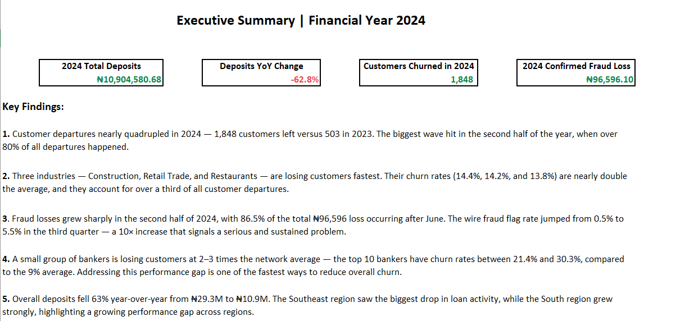
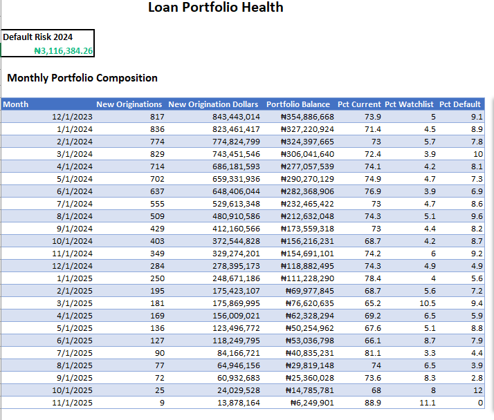
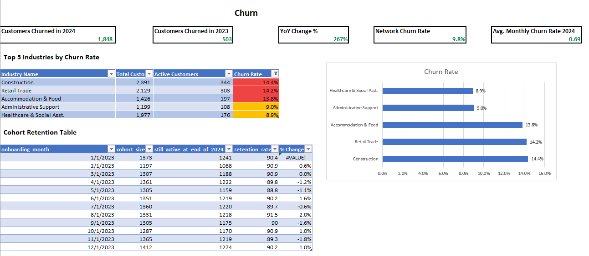
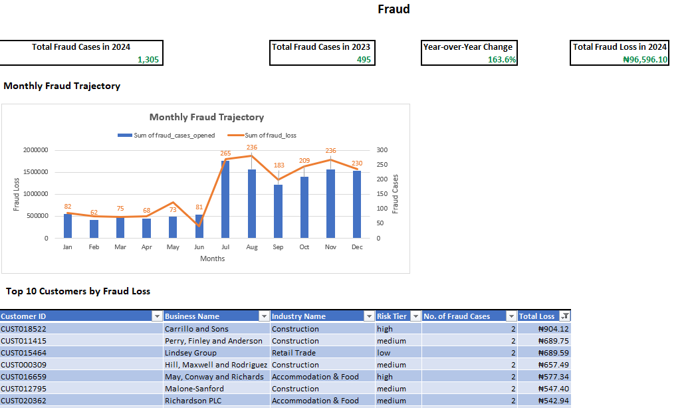
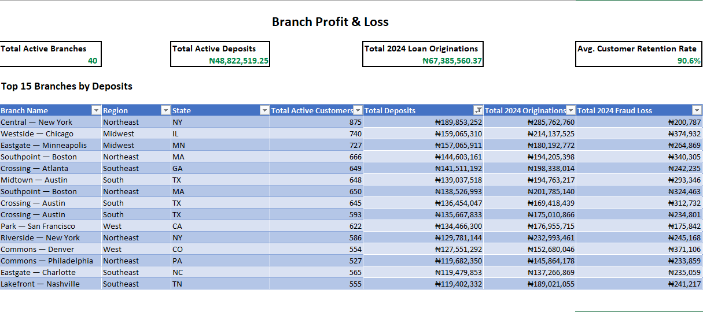
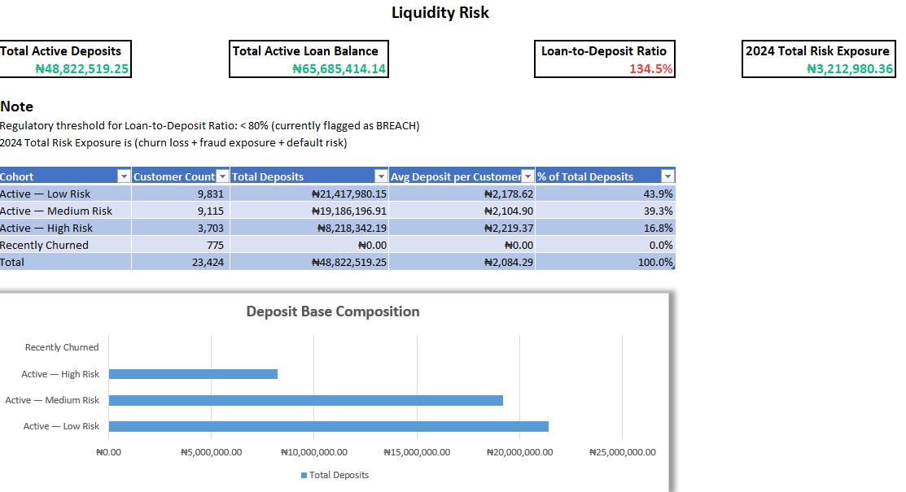
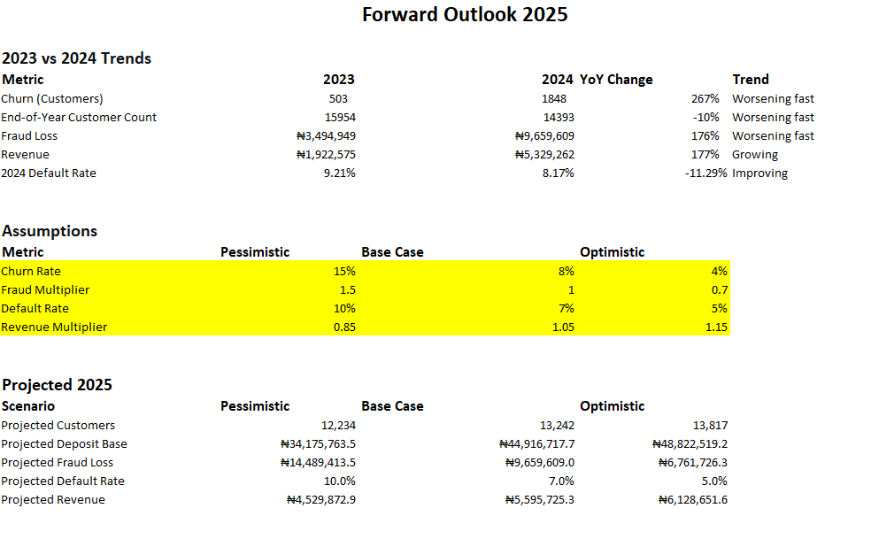

# Nexus Financial Services | Excel Board Reporting & Financial Analysis

**Tool:** Microsoft Excel  
**Industry:** Banking & Financial Services  
**Project Type:** DataSimHQ Business Simulation  
**Role:** Data Analyst

## 1. Business Problem

Nexus Financial Services, a simulated commercial bank, was experiencing several business and financial challenges that required management attention.

The leadership team needed a consolidated view of the bank's financial health, customer behavior, operational performance, and emerging risks.

The major concerns included:

- Increasing customer churn and declining customer retention.
- Rising fraud cases and potential financial losses.
- Deteriorating loan portfolio quality and default risk.
- Uneven deposit and loan performance across branches.
- Liquidity pressure caused by a high loan-to-deposit ratio.
- Limited visibility into future financial risks and business performance.

**Business Objective:** Analyze banking performance data and develop an Excel-based Board Reporting Pack that transforms financial and operational information into actionable insights, helping management identify risks, evaluate performance, and prioritize strategic decisions.

## 2. Analytical Approach

I developed a structured Excel reporting workbook covering seven major analytical areas.

| Analysis | What I Investigated |
|---|---|
| Executive Summary | Consolidated banking KPIs, financial performance, and critical business risks. |
| Loan Portfolio Analysis | Loan originations, portfolio composition, default rates, and industry-level credit risk. |
| Customer Churn Analysis | Customer departures, churn trends, industry segmentation, cohort retention, and branch-level churn. |
| Fraud Analysis | Fraud cases, financial losses, year-over-year changes, and customer-level fraud exposure. |
| Branch Profit & Loss | Branch-level deposits, loan originations, regional performance, and operational comparisons. |
| Liquidity Stress Analysis | Active deposits, outstanding loans, loan-to-deposit ratio, and financial stress scenarios. |
| Forward Outlook | Historical comparisons and 2025 pessimistic, base-case, and optimistic projections. |

## 3. Key Findings & Insights

### Customer Churn
- Customer departures increased from 503 in 2023 to 1,848 in 2024, representing approximately 267% growth.
- More than 80% of 2024 departures occurred during the second half of the year.
- Construction (14.4%), Retail Trade (14.2%), and Accommodation & Food (13.8%) recorded the highest industry churn rates.
- The analysis identified substantial differences in banker-level customer retention performance.

**Insight:** Customer retention requires targeted attention, particularly in high-churn industries and among underperforming relationship managers.

### Loan Portfolio Risk
- The reported network default rate was approximately 8.37%.
- Accommodation & Food (16.0%), Construction (14.8%), and Retail Trade (13.7%) had the highest industry default rates.
- Monthly loan originations declined substantially across the reporting period.
- The watchlist share increased from 4.9% in December 2024 to 11.1% in November 2025.

**Insight:** Strengthen credit-risk monitoring, introduce early-warning indicators, and investigate high-default industries.

### Fraud Analysis
- Reported fraud cases increased from 495 in 2023 to 1,305 in 2024, approximately 164% growth.
- The workbook identified a significant increase in wire-transfer fraud flags during 2024.
- Customer-level analysis highlighted repeat fraud cases and financial exposure.

**Insight:** Strengthen transaction monitoring, investigate changes in wire-transfer activity, and improve fraud-prevention controls.

### Branch Performance
- The workbook compared 40 active branches across five regions.
- The five highest-deposit branches accounted for approximately 16% of network deposits.
- The five lowest-deposit branches accounted for approximately 7%.
- Regional comparisons highlighted differences in deposit and loan activity.

**Insight:** Evaluate branch performance using deposits, lending activity, customer retention, and risk indicators before making resource-allocation decisions.

### Liquidity Risk
- The reported loan-to-deposit ratio was approximately 134.5%.
- This exceeded the workbook's 80% liquidity threshold and the 90% management comfort benchmark discussed in its recommendations.
- Regional analysis showed elevated loan-to-deposit ratios across all five regions.

**Insight:** Improve deposit mobilization, monitor lending growth, and develop a structured liquidity-management plan.

### Forward Outlook
Developed three financial planning scenarios:

- **Pessimistic:** Higher churn, increased fraud exposure, and weaker financial performance.
- **Base Case:** Moderate improvements under reasonable business assumptions.
- **Optimistic:** Stronger customer retention, lower fraud exposure, and improved revenue.

**Insight:** Scenario analysis helps management understand how different business conditions and corrective actions could affect future financial performance.

## 4. Management Recommendations

Based on the analysis, the workbook presents three major strategic priorities:

1. **Customer Retention:** Introduce 90-day onboarding reviews, investigate high-churn industries, and strengthen relationship-manager performance.
2. **Fraud Prevention:** Improve real-time wire-transfer monitoring, strengthen authentication controls, and establish dedicated fraud oversight.
3. **Capital & Liquidity Management:** Review branch-level resource allocation, strengthen deposit mobilization, and work toward reducing the loan-to-deposit ratio.

## 5. Excel Reporting Pack – Visual Preview

The following screenshots showcase the seven sections of the Excel Board Reporting Pack.

### 1. Executive Summary

### 2. Loan Portfolio Analysis

### 3. Customer Churn Analysis

### 4. Fraud Analysis

### 5. Branch Profit & Loss

### 6. Liquidity Stress Analysis

### 7. Forward Outlook

## 6. Project Deliverable

**[View / Download the Complete Excel Board Reporting Pack](Nexus_Board_Pack.xlsx)**

The workbook includes the executive summary, detailed financial and operational analysis, supporting calculations, methodology notes, scenario analysis, and management recommendations.

## 7. Skills Demonstrated

- Microsoft Excel
- Financial and Banking Analytics
- KPI Analysis and Reporting
- Customer Churn Analysis
- Loan Portfolio and Credit Risk Analysis
- Fraud Analytics
- Branch Performance Analysis
- Liquidity Risk Assessment
- Trend and Comparative Analysis
- Scenario and Forecast Analysis
- Business Intelligence
- Data-Driven Decision Support

## 8. Project Information & Limitations

- Nexus Financial Services is a fictional banking organization used in a DataSimHQ business simulation.
- This is an independent portfolio project, not an actual banking engagement.
- The workbook uses simulated banking data.
- Monetary values are labelled in Nigerian Naira (₦) in the workbook methodology.
- Historical analysis, assumptions, and forward-looking projections should be interpreted according to the supporting workbook documentation.
- Financial totals and currency scaling require reconciliation across certain reporting sections before the figures are treated as final.

---

**Part of:** Nexus Financial Services – Banking Analytics Portfolio Project.
